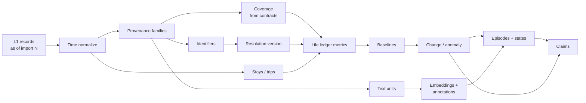

# PDL: Derived Meaning Architecture

2026-09-21 · R. L. Hallgarth

Source: https://claude.ai/code/artifact/a05e2cd2-a888-487e-8ba5-87be4c44ac0d

## Summary

**Version 2.2: accepted architecture.** This version merges two independent designs (Claude and GPT) and two rounds of cross-review. A red-team pass found boundary issues but no reason to replace the core; its fixes are in section 18 and invariants 32–44, including deletion. This is the architecture of record; build starts with phases 0–3.

PDL adds a **derivation layer built as a versioned, partitioned dataflow inside PostgreSQL**. It ends in a **claims ledger** where every conclusion carries its epistemic class, evidence, contradictions, and a confidence profile specific to its claim type. LLMs work only at the edges: routing questions onto validated templates, annotating bounded text, and writing cited prose from finished findings. Everything between is deterministic or statistical, reproducible, and replayable against any past state of the evidence.

The load-bearing decisions:

- **Aggregate early.** Most meaning lives in a daily life ledger (\~11,000 days for 30 years), not in raw records.
- **Observation contracts.** Every source declares what it can observe. Every metric declares what zero and missing mean. Unknown is never zero.
- **Versioned, reversible identity.** Entities are clusters of identifiers built from an assertion log.
- **One-way valve.** Evidence flows up into claims and narratives. Narratives never flow back down as evidence.
- **As-of replay.** Canonical evidence can be reconstructed as of any retained import, so PDL can say *why* an answer changed: evidence, identity, method, model, or policy.
- **Templates before composition.** Closed analysis templates first; a constrained operator planner only once operators are validated; never freestyle AI analysis.
- **Restriction only tightens.** Sensitivity and egress propagate through derivation as a lattice. Loosening requires your explicit, recorded authorization.
- **Postgres is the system of record; DuckDB is the analytical engine.** Parquet snapshots come later, only if scans get slow.

### Limits on the premise

- PDL models **digital evidence about a life, not the life itself**.
- It reports **associations**, never causes. "Habits that precede productivity" becomes lagged association with effect sizes, FDR control and held-out validation.
- "Closer or more distant" is a **hypothesis** unless you define it as a metric. PDL measures interaction: volume, reciprocity, latency, initiation, channel mix.
- "Beliefs, goals, concerns" become **recurring topics you wrote, searched or asked about**. Inner states are never asserted as fact.
- Pattern discovery without multiple-comparison control produces horoscopes. It is the last phase, not the first.

## Invariants

These rules are fixed before implementation. Every later section implements one or more of them.

1. Canonical evidence is never rewritten by derived meaning.
2. Unknown is never silently converted to zero.
3. Every source declares what it can and cannot observe.
4. Every derived value identifies exactly what produced it.
5. Every derivation declares its partition class (LOCAL, HALO or GLOBAL) and, for HALO, its temporal dependency halo.
6. Identity resolution is versioned and reversible.
7. Semantic output never masquerades as deterministic measurement.
8. Narratives never become evidence.
9. Duplicate evidence does not create fake corroboration.
10. Contradictory evidence is actively sought and preserved.
11. Temporal statistics never assume samples are independent; they account for autocorrelation.
12. Discovery controls multiple comparisons and requires validation on withheld time; otherwise it is labelled exploratory.
13. Baselines are explicit, versioned, checked for contamination, and chosen by a fallback order declared in advance.
14. Analysis begins with validated templates.
15. General composition comes only after the operators themselves are trusted.
16. Confidence is multidimensional and claim-type-aware.
17. Local time and temporal precision are preserved.
18. Sensitive data has an explicit egress policy.
19. PDL models digital evidence about a life, not life itself.
20. Any derived layer can be destroyed and rebuilt without reimporting canonical evidence.
21. Every analysis run pins its complete version vector: evidence as-of import, identity resolution, derivation versions, semantic models, and policy.
22. Canonical evidence supports faithful as-of reconstruction for any retained import state, except evidence you have purged.
23. Your declarations are first-class, versioned evidence. Derived processes may reference them or supersede machine interpretations, but never overwrite declarations.
24. Derived objects inherit the most restrictive egress and sensitivity of their inputs. Restriction may tighten automatically; loosening requires explicit human authorization, which is itself recorded.

**Corollary:** derivation may increase sensitivity or restriction. It may never silently decrease either.

**Added with the forecasting layer and domain packs:**

25. No predictive model is shown until it has demonstrated out-of-sample calibration on history it was not trained on.
26. Every forecast has an expiry, is scored against what actually happened, and its misses are kept.
27. A forecasting model must beat naive baselines (base rate and persistence) before it is shown.
28. A mental or emotional state counts as evidence only when someone stated it, linked to the exact quote. Inferred states are hypotheses.
29. Cloud models are locked behind your authorization. Nothing leaves the machine until you allow it, per source or domain, and every authorization is recorded.

30) Every displayed analytical assertion has an inspectable derivation path that terminates in something concrete: a canonical source record, source or coverage metadata, or an identified declaration by you. If no such path exists, PDL does not present the assertion as a finding.
31) Inspecting an answer reproduces the derivation state that answer used. It never silently substitutes today's evidence, identity mapping, algorithms or policy.

**Added after the red-team pass (section 18):**

32. No time-indexed analysis or forecast may consume information that was not available at its declared information cutoff.
33. Every persisted analysis stores an immutable provenance capsule sufficient to inspect the answer without rerunning historical derivations.
34. Ingested content is untrusted data. Source text can never become executable instruction, tool authority or policy.
35. Derived dependency graphs are acyclic. A claim cannot build its own evidentiary strength through other claims.
36. Confidence components are numeric only when their scale has defined empirical meaning; otherwise they stay native measures or thresholded states.
37. Observation-contract versions are part of the version vector and the answer-drift model.
38. Review queues fail unresolved, never optimistic. Unreviewed identity stays unmerged, unnamed periods stay unnamed, labels stay hypotheses.
39. Deletion is an explicit, destructive state transition, never a mutation pretending evidence never existed. Purging evidence you ask to delete is the only way canonical evidence disappears.

40) Permanent deletion overrides historical reproducibility. PDL never retains deleted evidence to preserve replay.
41) A purge traverses the derivation graph and recomputes, redacts or destroys every dependent artifact, including embeddings, annotations, summaries, capsules, caches, forecasts, eval labels, identity assertions and exported snapshots.
42) Purged evidence never becomes evidence of absence. Its gaps are coded as purged, never as zero.
43) A purge is complete only when PDL produces a deletion verification report listing every storage location checked and any backup copy that still exists, with its expiry.
44) Historical answers affected by a purge say so explicitly, and tombstones reveal no more than you chose to keep.

## 1. Core mental model

PDL is eight layers plus three cross-cutting systems. Each layer reads only from layers below it. Every object in every layer carries one of seven epistemic classes.

### Layers

| Layer | Holds | Typical class | Mutability |
| --- | --- | --- | --- |
| L0 Raw | Original exports, content-addressed | observed | Never changes |
| L1 Canonical evidence | Records, observations, assets, provenance (exists today) | observed | Append-only; corrections are supersessions tracked by import |
| L2 Identity | Identifiers, entities, resolution decisions | computed, statistical, declared | Versioned |
| L3 Measurements | Deterministic time-bucketed quantities, coverage | computed | Rebuildable |
| L4 Signals and annotations | Baselines, change points, anomalies, cycles, associations; semantic annotations | statistical, semantic | Rebuildable, versioned |
| L5 Episodes and states | Periods, trips, project spans, interaction-state series | statistical, semantic, declared | Versioned |
| L6 Claims | Assertions with evidence, contradictions, confidence profile | any, stated explicitly | Versioned, supersedable |
| L7 Narratives | Prose for one question and one run | narrative | Ephemeral cache; never an input |

### Cross-cutting systems

- **Evidence ledger:** what evidence exists, where it came from, which provenance family it belongs to, and what PDL knew as of each import.
- **Derivation DAG and registry:** exactly how every derived object was produced, and what depends on it.
- **Epistemic and policy model:** what kind of statement each object is, and what PDL may do with it (sensitivity and egress).

### Epistemic classes

| Class | Means | Example |
| --- | --- | --- |
| OBSERVED | Source evidence says this | A message was sent at 21:14 local time |
| COMPUTED | A deterministic transformation says this | 41 messages to Person X that day |
| STATISTICAL | A statistical inference says this | A change point in weekly volume near 2024-11-02 |
| SEMANTIC | A semantic model says this | This conversation's topic is "moving" |
| DECLARED | You explicitly said this | "This period was the new job" |
| HYPOTHESIS | The system proposes this | "Relationship with Person X became closer" |
| NARRATIVE | A prose rendering says this | The paragraph in an answer |

A declaration is not "more true" than an observation. It is authoritative about what you declared, and it is stored separately so no derivation can blend it away.

A forecast is an object type, not an epistemic class (section 16). Its signature is usually a STATISTICAL final inference over COMPUTED and OBSERVED inputs.

### Object taxonomy

The classes above describe *how* something is known. The taxonomy below describes *what kind of object* it is. Keeping them apart is what stops semantic guesses from sitting next to counts.

| Object | Definition | Examples |
| --- | --- | --- |
| Measurement | Deterministic observable quantity | messages/day, response latency, home-presence hours, commits/week |
| Statistical signal | Mathematical inference over measurements | Change point in message volume, anomaly, trend, association |
| Semantic annotation | Model-derived interpretation of bounded content | topic = "divorce", intent = "job search" |
| State | Time-segmented description built from measurements and signals | "High, reciprocal, daily contact", residence at Place 12 |
| Claim | Assertion supported by lower layers | "Interaction with Person X fell 70% in Q3 2021 versus the trailing year" |
| Hypothesis | Interpretation not sufficiently established | "The relationship became closer", unless you define closeness as a metric |

Rules that follow:

1. **Downward references only.** Nothing points upward. L3–L7 can be deleted and rebuilt from L0–L2 plus the registry.
2. **Signatures, not ranks.** Classes are not a trust ladder, so there is no single "weakest class". Each object carries an epistemic signature: the set of classes it depends on plus its final inference step (section 18). Arithmetic on semantic annotations still depends on SEMANTIC, and its signature says so.
3. **You can promote a construct.** If you define "closeness" as a formula over measurements, it becomes a declared construct, and its values are a declared construct index: computed exactly, but always shown with the construct's name and definition ("0.72 on your closeness index", never "72% close"). The same applies to any invented construct such as stability, engagement or productivity. Without a definition it stays a hypothesis.

## 2. Proposed architecture

Four planes over one PostgreSQL system of record. The existing ingestion system becomes the Evidence plane unchanged, except that canonical rows gain import-visibility columns. Everything new grows above it.

```
+--------------------------------------------------------------------+
| PRESENTATION   Adaptive cockpit: fixed component registry,         |
|                evidence inspector, drift view                      |
+---------------------------------^----------------------------------+
                                  | AnalysisResult (JSON)
+---------------------------------+----------------------------------+
| REASONING      Router (LLM) -> template + params (validated)       |
|                [later] constrained operator planner                |
|                Plan executor: stats, graph, episodes, retrieval    |
|                Evidence challenge -> findings bundle               |
|                Egress filter -> Synthesizer (LLM) -> Validator     |
|                Drift analyzer (replays pinned runs)                |
+---------------------------------^----------------------------------+
                                  | claims, episodes, signals, metrics
+---------------------------------+----------------------------------+
| DERIVATION     Registry + DAG + partition scheduler                |
|                (LOCAL / HALO / GLOBAL; GLOBAL debounced)           |
|  Time normalize | Provenance families | Coverage | Identity        |
|  Metrics (life ledger) | Baselines | Change/anomaly/cycles         |
|  Text units | Embeddings | Semantic annotation (local model)      |
|  Episodes/states | Claim evaluator | Policy propagation            |
+---------------------------------^----------------------------------+
                                  | change feed + as-of views
+---------------------------------+----------------------------------+
| EVIDENCE       Raw artifacts (L0) | Import provenance | Canonical   |
| (exists)       records/assets (L1) + arrived_in / superseded_in    |
|                Source observation contracts | Declarations        |
+--------------------------------------------------------------------+

Cross-cutting: Evidence ledger | Derivation registry | Epistemic + policy model

Storage: Postgres (truth, pgvector)   DuckDB (analytics, reads Postgres)
         [later] Parquet snapshots     Local model runtime (llama.cpp/Ollama)
```

| Component | Responsibility | Decision |
| --- | --- | --- |
| Observation contracts | Per source: what it can observe, over what dates, and what a gap means | Declared in each adapter; the coverage deriver reads them |
| Declarations | Your episodes, merges, rejections, metric definitions, egress overrides | Own tables and class; versioned; never overwritten |
| Deriver registry | Each deriver's inputs, outputs, partition class, halo, epistemic class, version hash | Postgres tables plus Python decorators. No Dagster: lineage lives next to data. |
| Partition scheduler | Dirty tracking per (deriver version, partition); debounces GLOBAL jobs | Postgres queue with `FOR UPDATE SKIP LOCKED` |
| Time normalizer | UTC interval, time precision, and local time zone per observation | Local zone derived from location where known |
| Coverage | Per source × day completeness, with reasons for gaps | Built before any metric |
| Identity resolver | Identifiers → entities from an assertion log | Rules, then Splink, then your review |
| Metric and signal derivers | Life ledger, baselines, change points, anomalies, cycles, associations | DuckDB + Python stats stack |
| Semantic annotator | Topics and event mentions on bounded text units | Local model; outputs are annotations |
| Policy propagation | Computes sensitivity and egress for every derived object | Lattice max over inputs (section 9) |
| Claim evaluator | Re-scores standing claims when evidence changes | Emits strengthen, weaken, supersede, retract |
| Drift analyzer | Explains why a pinned answer differs today | Counterfactual replay (section 11) |
| Analysis engine | Question → template → findings → cited prose | LLM only at router, annotation and synthesis |

## 3. Data model

Eight schemas. Three column groups appear on every derived row and are non-negotiable: `deriver_version_id`, `resolution_version_id` (if entity-keyed), and `sensitivity` + `egress`. Without them nothing can be rebuilt, replayed or safely shared.

**Schema `evidence` (additions to the existing ingestion tables)**

| Table / columns | Key fields | Purpose |
| --- | --- | --- |
| canonical rows: new columns | `arrived_in_import`, `superseded_in_import` (nullable), `provenance_family_id` | As-of visibility and independence |
| `import_state` | import\_id, sequence, completed\_at, retained | Ordered import history; which states can be replayed |
| `source_contract` | source, contract\_version, observable\_kinds, covered\_range, gap\_semantics (not\_exported, deleted\_by\_provider, device\_absent, unknown) | What each source can and cannot see |

Canonical evidence as of import N is defined as:

```sql
arrived_in_import <= N
AND (superseded_in_import IS NULL OR superseded_in_import > N)
```

That is what the system actually knew after import N, including corrections, not merely which records first appeared by then.

**Schema `declare` (your assertions)**

| Table | Key fields | Purpose |
| --- | --- | --- |
| `declaration` | kind (episode, identity\_merge, identity\_split, not\_same\_as, metric\_definition, label, egress\_override), payload, valid\_during, version, supersedes, declared\_at | Everything you assert, versioned, never overwritten by derivation |

**Schema `policy`**

| Table / columns | Key fields | Purpose |
| --- | --- | --- |
| `sensitivity`, `egress` columns | On sources, metric definitions, and every derived row | What the data is; what PDL may do with it |
| `egress_override` | object\_ref, from\_level, to\_level, reason, declaration\_id | The only way restriction ever loosens, with provenance |
| `policy_version` | id, lattice definition, redaction rules hash | Part of every version vector |

**Schema `derive` (lineage and orchestration)**

| Table | Key fields | Purpose |
| --- | --- | --- |
| `deriver` | name, outputs, epistemic\_class, partition\_class (LOCAL / HALO / GLOBAL), lookback\_halo, lookahead\_halo | What a derivation is and what it depends on in time |
| `deriver_version` | code\_semver, params\_hash, model\_id, weights\_hash, prompt\_hash, version\_hash, status (shadow / active / retired) | Exactly what produced an output |
| `deriver_dependency` | upstream, downstream, partition\_mapping | The DAG |
| `partition_state` | deriver\_version, partition\_key, input\_fingerprint, state, dirty\_since, computed\_at | Dirty tracking, fingerprint short-circuit, GLOBAL debounce |
| `derivation_run` | run\_id, deriver\_version, partitions, timings, stats | Audit of every execution |

**Schema `ident`**

| Table | Key fields | Purpose |
| --- | --- | --- |
| `identifier` | kind (phone, email, handle, account\_id, device\_id, repo\_url…), normalized\_value | Atomic handles |
| `identifier_occurrence` | identifier, record\_id, role | Links evidence to identifiers |
| `entity` | entity\_id, kind (person, org, place, device, account, project, document, named\_concept), display\_name | Durable referents only; no machine topics |
| `identity_assertion` | pair, relation (same\_as, not\_same\_as, belongs\_to, part\_of), method (rule / model / declared), score, evidence | Every decision, including rejections |
| `resolution_version` | id, assertion\_set\_hash | A frozen clustering |
| `entity_membership` | resolution\_version, identifier, entity, valid\_during | Time-bounded mapping (reassigned numbers) |
| `entity_relation` | from, to, relation, valid\_during, class, confidence | Graph edges |

**Schema `measure` (L3)**

| Table | Key fields | Purpose |
| --- | --- | --- |
| `metric_def` | metric\_key, unit, grain, domain, definition, zero\_is\_observed\_value, missing\_is\_zero (always false unless declared), min\_observability, comparable\_coverage\_required, sensitivity, egress | The metric catalog and its observation contract |
| `metric_value` | metric\_key, entity\_id, bucket\_start, grain, value (NULL = unobservable), n\_obs, coverage, versions | Long-format life ledger, partitioned by year |
| `coverage` | source, bucket\_start, grain, expected, observed, completeness, gap\_reason | What PDL could have seen |

Every `metric_value` row also carries `value_basis`: `explicit` (the source recorded the value), `absence_implies_zero` (no records, and coverage plus contract prove they would have been seen), `unobservable`, `provider_deleted`, or `estimated`. That keeps all the states of "nothing" distinct even when two of them share `value = 0`.

Purged evidence gets `value_basis = purged` and `gap_reason = purged_by_user`. Without that, deleting June 2021's messages would quietly turn into "no messages in June 2021", a false finding about a gap you created yourself.

**Schema `signal` (L4–L5)**

| Table | Key fields | Purpose |
| --- | --- | --- |
| `baseline` | metric\_key, entity, as\_of, window\_kind, range, center, spread, method, contamination\_status | Explicit, versioned baselines |
| `signal` | kind (change\_point, anomaly, trend, cycle, association), metrics, entity, during, effect\_size, interval, stat, method, status (candidate / exploratory / validated) | Statistical signals |
| `text_unit` | kind (conversation session, document, AI chat, note), during, record\_ids | What gets embedded and annotated |
| `annotation` | unit\_id, kind (topic, event\_mention, intent), value, score, versions | Semantic outputs |
| `embedding_<space>` | unit\_id, vector | One table and index per embedding space |
| `episode` | kind, origin (declared / derived / detected), start\_range, end\_range, label, label\_origin, class, confidence\_profile | First-class periods with uncertain edges |
| `state_series` | entity, state\_kind, during, state, basis\_metrics, confidence\_profile | Interaction, residence, employment states |

**Schema `know` (L6–L7 and analysis)**

| Table | Key fields | Purpose |
| --- | --- | --- |
| `claim_template` | template\_key, version, statement\_pattern, epistemic\_class, confidence\_schema (required and optional dimensions) | Code-defined claim types and how they are judged |
| `claim` | template, params, subjects, during, class, confidence\_profile, grade, limited\_by, status (current / superseded / retracted), supersedes, sensitivity, egress | The knowledge ledger |
| `claim_evidence` | claim\_id, evidence\_ref (record, metric\_slice, signal, episode, annotation, declaration; a claim only in the contextualizes role), role (supports / contradicts / qualifies / contextualizes), weight | Why PDL believes it |
| `analysis_template` | key, version, baseline\_policy (ordered list), metric sets, default components | Closed, validated analyses |
| `analysis_run` | run\_id, question, template, params, version\_vector, requested\_baseline, actual\_baseline, fallback\_reason, result\_json | Reproducible executions |
| `drift_report` | run\_a, run\_b, factors\_changed, swap\_order, per-factor effect, classes | Why an answer changed |
| `narrative` | run\_id, text, span citations, model, prompt\_hash, validation\_report | Cached prose; never read by derivers |

The **version vector** on `analysis_run` is: `as_of_import`, `resolution_version`, active `deriver_version` per deriver used, semantic model and embedding space IDs, `policy_version`, and `analysis_template` version.

The vector also includes every observation-contract version the run touched (invariant 37). Each run additionally records its information cutoff, its replay fidelity, and its provenance capsule (section 18). Entity-keyed rows store a per-entity `membership_fingerprint` rather than the global resolution version, so correcting one contact does not make the whole life ledger look stale.

A `metric_slice` evidence reference is a query spec plus a hash of its result, not a copy of rows. It stays compact and can be re-checked under any version vector.

## 4. Derivation pipeline

A deriver is a pure function: `(input partitions, version vector) → output partition`. The same inputs and version hash give the same output. Semantic derivers are the exception: they are not truly pure even at temperature 0, so their actual outputs are persisted as the historical artifact and each run records its replay fidelity (section 18).



Policy propagation runs alongside every step: each output's sensitivity and egress are the lattice maximum of its inputs (section 9).

The stages, and why each exists:

1. **Time normalization.** Every observation gets `during` (a tstzrange), `time_precision` (second, day, month), and `local_tz`. A photo with EXIF local time and no offset keeps a flagged precision instead of a guessed UTC.
2. **Provenance families.** The same iMessage from an iPhone backup and from Mac `chat.db`, or the same photo in Google, Apple and Facebook, belongs to one family. Families, not record counts, measure corroboration.
3. **Coverage.** Driven by each source's observation contract. Records expected versus observed per day, and the reason for any gap.
4. **Identity.** Extract identifiers and apply the current resolution version (section 5).
5. **Spatial derivation.** Raw fixes → stay points → clustered places → trips. Millions of pings become thousands of stays.
6. **Measurements.** Deterministic aggregates into the life ledger, honoring each metric's zero and missing semantics.
7. **Signals.** Baselines, change points, anomalies, cycles (section 6).
8. **Text units, embeddings, annotations.** Messages are grouped into conversation sessions (a 45-minute gap splits one). Units are embedded and annotated, not single messages: 10–50× fewer vectors, each with more meaning.
9. **Episodes and states.** From signals, stays, annotations and your declarations.
10. **Claims.** Generated from signals by code templates, not by an LLM, then linked to supporting and contradicting evidence.

### Partition classes

Every deriver declares one class. This is what makes incremental work generic instead of special-cased per algorithm.

| Class | Recompute scope | Examples | Halo (back / ahead) |
| --- | --- | --- | --- |
| LOCAL | Only the changed partition | Daily message count, stay points | 0 / 0 |
| HALO | Changed partition plus its declared halo | 30-day trailing mean; centered 14-day smoother; 365-day baseline; episode detector | 29d / 0; 7d / 7d; 365d / 0; 30d / 30d |
| GLOBAL | The whole series, entity or metric | PELT segmentation, relationship state series, Splink clustering, topic clustering | Unbounded |

GLOBAL partitions are marked dirty immediately but **debounced**: they run once after an import batch settles (or on a schedule), so importing three archives does not segment thirty years of history three times.

Materialization policy: persist L2–L6 always. Cache L7 by (run, version vector) only. Don't store what is cheap to compute on the fly from `metric_value`.

## 5. Entity resolution

Entities are **clusters of identifiers, recomputed from an assertion log**. The log is the source of truth; clusters are a derived, versioned view. Raw identifiers are never rewritten into names, merges are reversible, and a wrong merge is treated as worse than two entities left temporarily separate.

The resolver runs in three tiers:

1. **Hard rules (COMPUTED).** A contact card listing a phone and an email; an OAuth ID tied to an email; the same Apple ID across devices. These cover most real people.
2. **Probabilistic matching (STATISTICAL).** Fellegi–Sunter scoring with **Splink** on DuckDB: name similarity, shared co-participants, overlapping active periods, shared threads. High scores auto-link for non-person entities. Person candidates below a high threshold go to review.
3. **You (DECLARED).** Confirm or reject queued pairs. A `not_same_as` declaration stops the matcher proposing the same wrong link forever. The queue is ordered by impact: your top 200 correspondents first.

LLMs may *suggest* links into the review queue. They never merge people.

When an assertion changes, a new resolution version is cut. Only partitions keyed to the affected entities go dirty. Canonical records never change.

| Kind | Approach |
| --- | --- |
| People | Three tiers. Time-bounded membership: a phone number reassigned in 2019 maps to a different person after that date. |
| Organizations | Email domains, calendar and document mentions, payees; normalized names with aliases. Mostly rules. |
| Places | Stay-point clusters are the entity; venue names are attributes. "Home" and "work" are time-bounded states, not place properties. |
| Devices and accounts | Device IDs, user agents, OAuth IDs. Nearly all rules. |
| Projects | Seeded from repos, top-level folders, calendar series, recurring AI-chat topics. Suggested automatically, confirmed by you. |
| Documents | Content hash plus fuzzy hash; the version chain is part of the entity. |
| Relationships | Not entities. A `state_series` between you and a person, built from interaction measurements. |

### Topics are not entities

Machine-discovered topics come from clustering, and a new embedding model can reorganize them completely. So:

- **Machine-discovered topic → versioned semantic annotation.** Examples: "AI", "cars", "software architecture".
- **Referent you establish → entity** of kind `named_concept`. Examples: *The Hallway*, PersonalDataLab. You name it, it anchors analyses, and it survives model changes. Its link to text units is still an annotation, so it can be re-derived.

## 6. Temporal and behavioral analysis

The spine is the **daily life ledger**: one value per metric per day, masked by coverage, in local time. At \~11,000 days × \~2,000 metrics it is about 22 million cells, which DuckDB scans in seconds. Hourly and weekly grains exist only for metrics that need them.

**Standing rule: never assume temporal samples are independent.** Tuesday resembles Monday because behavior has momentum. Every uncertainty estimate uses a method that respects that: block bootstrap, permutation that preserves temporal structure, HAC-style standard errors, or an explicit time-series model.

| Question type | Method |
| --- | --- |
| Baseline | Robust center and spread (median, MAD) per baseline kind below, with day-of-week adjustment |
| Change | PELT (`ruptures`) on history, GLOBAL class; Bayesian online change point for new data |
| Anomaly | Robust z against baseline, only where coverage meets the metric's `min_observability`; stores observed value, expected range, baseline used, distance, coverage, method |
| Trend | Theil–Sen slope; STL decomposition for seasonal series |
| Cycles | STL and periodogram at weekly, monthly and annual scales |
| Before / after | Standardized effect size with block-bootstrap interval |
| Stability | Rolling multivariate dispersion across a domain's metrics |
| Association | Discovery gate below; never phrased causally |

### Baselines

Baseline kinds are persisted objects: preceding matched window, same weekday over prior 12 weeks, same months in prior years, trailing 90 and 365 days, lifetime distribution, pre-event window.

Each analysis template declares an **ordered baseline policy** in advance. The default for before/after comparisons:

1. Immediately preceding matched window
2. Seasonally matched prior-year window
3. Trailing multi-year baseline
4. Mark the comparison contaminated or insufficient

Each candidate gets a **contamination check**: scan it for precursor change points and coverage shifts. The first acceptable candidate is used. PDL never searches for a baseline that produces a larger or cleaner effect. Every run records `requested_baseline`, `actual_baseline` and `fallback_reason`, and the UI shows them.

### Episodes

Episodes are first-class, stored with **uncertain boundaries** (a start range and an end range). Forming an episode and labelling it are separate steps.

- **Declared.** You name a period. DECLARED class.
- **Derived.** Deterministic rules within one domain: trips (away from home places 2+ nights), project spans, jobs (payroll payee plus calendar plus work location).
- **Detected.** Change points per domain, then dates where changes in *independent* provenance families cluster within a few weeks. A candidate stays "Unnamed period, Mar–Aug 2019" until you look at it. Any label suggested by an LLM is a HYPOTHESIS.

Cross-source reasoning mostly happens here. An episode bounded by agreeing changes in five independent families is far stronger than one visible in one source, and the confidence model rewards that explicitly.

### Interaction dynamics

Per person, monthly: volume each way, initiation share, reciprocity, median response latency, channel mix, active hours, co-location days, shared calendar events, photo co-occurrence. Change points segment this into `state_series` states described in metric terms: "high, reciprocal, daily", "declining, you initiating 80%". "Closer" or "more distant" appears only if you have declared a closeness definition; otherwise it is a hypothesis.

### Discovery gate

Mining for patterns you never noticed is only allowed through this sequence:

1. Candidate generation over declared metric families, lags and windows (the search space is counted and recorded)
2. Effect-size floor
3. Benjamini–Hochberg FDR correction over the full recorded search space
4. Robustness across window and lag choices
5. Validation on withheld time (for example, discover on 2015–2021, confirm on 2022–2025)
6. Only then: status `validated` and eligible to become a claim

Without enough history for step 5, the result is labelled `exploratory` and shown as such. It never becomes a claim.

## 7. Role of LLMs

LLMs are **translators at the edges and annotators of bounded text**. They are never calculators, judges of significance, or authors of facts.

| Use | Where | Output class | Guardrail |
| --- | --- | --- | --- |
| Question → template + parameters | Router | a plan, not a claim | Validated against the template catalog, metric catalog and entity table. Unknowns are rejected, not improvised. |
| Question → operator DAG (later phase) | Constrained planner | a plan | Restricted operator DSL; only validated operators; no SQL or Python; plan is persisted |
| Text annotation | Semantic annotator | SEMANTIC | Closed label sets where possible; model and prompt pinned; spot-check per new version |
| Event extraction | "I start at the new place Monday" | HYPOTHESIS | Becomes a candidate episode boundary, never a declared one |
| Identity suggestions | Review queue | suggestion | Never auto-applied for people |
| Episode and claim labels | After detection | HYPOTHESIS | Shown as a suggestion until you accept it; acceptance creates a DECLARED label |
| Synthesis | Final step | NARRATIVE | Cited, validated, never stored as evidence |

**Not for:** counting, aggregation, statistics, exact temporal joins, significance, ranking importance, estimating coverage, judging source independence, merging identities, reading raw corpora per query, creating canonical facts, or asserting mental states.

### Keeping model output out of the fact base

1. **Structural valve.** `narrative` has no downstream consumers; the registry refuses any deriver that lists it as input.
2. **Claims come from templates.** An LLM can create only SEMANTIC or HYPOTHESIS objects. Promotion requires non-LLM evidence or your declaration.
3. **Bounded input.** The synthesizer receives only the egress-filtered findings bundle, never raw data.
4. **Cited output.** Every sentence carries at least one claim ID.
5. **Validator.** A deterministic checker confirms cited claims exist, matches every number and date in the prose against claim payloads, and flags causal verbs unless the claim supports a sequence. Failure means regenerate once, then fall back to a templated summary.
6. **Visible class.** The UI renders narrative distinctly from findings, span-linked to evidence.
7. **No recursive summaries.** Period summaries are built by deterministic aggregation of claims, never by summarizing earlier summaries.

**Privacy decision.** Semantic annotation and synthesis run on a local model by default. Each `metric_def` and source carries a sensitivity tier (health, finances, intimate communication are highest). Sensitivity and egress are tracked separately, and a cloud model sees only what the egress filter lets through.

### Sensitivity and egress

The two answer different questions and are never collapsed:

- **Sensitivity: what the data is.** normal, private, financial, health, intimate, credential\_like.
- **Egress: what PDL may do with it.** An ordered lattice: `external_model_allowed` < `redactable` < `local_only`.

A mundane document can be `normal` and `local_only` because you said so. Financial data can be `financial` and `redactable` with strong sanitization.

Propagation rules:

```
egress(output)      = MAX_RESTRICTION(egress of all inputs)
sensitivity(output) = union of input sensitivities

less restrictive -> more restrictive   automatic
more restrictive -> less restrictive   only by egress_override (a recorded declaration)
```

The egress filter runs before synthesis: `local_only` findings go only to a local model; `redactable` findings are redacted by rule, then re-classified; only `external_model_allowed` content may leave the machine.

## 8. Query planning

Planning grows in three stages, each gated on the one before:

```
v1     question -> template -> parameters        (closed catalog)
later  question -> validated operator DAG        (constrained composition)
never  question -> freestyle AI analysis
```

The v1 catalog has eight templates: `period_profile`, `period_change`, `relationship_history`, `entity_timeline`, `attention_allocation`, `baseline_deviation_scan`, `cross_source_event`, `recurring_theme`. Each declares its metric sets, baseline policy, claim templates and default UI components. New question types become new templates.

The later planner composes only from operators that already have validated behavior inside templates (RESOLVE, WINDOW, COMPARE, AGGREGATE, TREND, CHANGE\_POINT, ANOMALY, GRAPH, RETRIEVE, CORRELATE). Its plans are persisted and replayable like any run.

### Walkthrough: "What changed about my life during the six months before I started Project X?"

1. **Route.** The LLM maps the question to `period_change` with `anchor = Project X`, `anchor_point = start`, `focal = 6 months before`. Output is validated JSON.
2. **Resolve the anchor.** Project X's start is itself derived: first commit, first linked document, first calendar event, first AI-chat mention, or a DECLARED start if you gave one. If candidates disagree by more than 30 days, the run stops and asks you, showing them. Anchor uncertainty carries into every finding.
3. **Pick the baseline by policy.** Run the template's ordered baseline policy with contamination checks; use the first acceptable candidate. Record requested, actual and fallback reason.
4. **Check coverage.** Per source family, compare completeness across focal and baseline windows against each metric's contract. Sources failing it are excluded and listed as caveats.
5. **Select metrics.** The template's metric set by domain (communication, location, work, digital attention, spending, sleep and activity, content creation), filtered by coverage.
6. **Compute diffs.** Effect size with block-bootstrap interval per metric. Findings must first pass the claim template's evidence gates; eligible findings are ranked by relevance to the question and effect magnitude. Confidence is displayed separately, never multiplied into the ranking.
7. **Entities.** People whose interaction state changed; people, places and organizations first seen in the window.
8. **Episodes and signals.** Overlapping episodes, change points inside the window, and which independent families changed near each other.
9. **Semantic layer.** Emerging and fading topics, focal versus baseline, then 3–5 **exemplar** text units per top shift, chosen by centrality in that window. Statistics decide what matters; vectors only fetch examples.
10. **Evidence challenge.** For each top finding, run the claim template's pre-declared challenge specification: known counter-metrics, alternate channels, and the allowed alternative windows. Any open-ended contradiction search logs its search space and uses the same multiple-comparison control as discovery.
11. **Assemble.** Findings become claims (reusing standing claims where they match), each with a confidence profile from its claim template. The bundle is persisted as an `analysis_run` with its full version vector.
12. **Filter and synthesize.** The egress filter prepares the bundle; the LLM writes cited prose; the validator checks it.

Steps 2–11 involve no LLM. Replaying the run with the same version vector yields identical findings; only the prose can vary.

## 9. Provenance and confidence model

Confidence is a **profile**, not a probability. Each claim template declares which dimensions apply to it. The grade uses weakest-link logic across the **required** dimensions only, and always names the one that limited it.

### Dimensions

| Dimension | Measures |
| --- | --- |
| coverage | Completeness of the sources used, in every window |
| statistical\_strength | Effect size and interval width relative to baseline noise |
| robustness | Survives alternative windows, lags and thresholds |
| identity | Weakest resolution link among the entities involved |
| source\_independence | Number of distinct provenance families that agree |
| anchor | Uncertainty in dates that define the windows |
| semantic\_reliability | Agreement and spot-check accuracy of the annotations used |
| temporal\_precision | Precision of the timestamps involved |
| spatial\_precision | Accuracy of the location fixes involved |

### Schemas per claim type

```
communication_change:
  required: coverage, identity, statistical_strength, robustness
  optional: source_independence

topic_change:
  required: coverage, semantic_reliability, robustness

location_change:
  required: coverage, temporal_precision, spatial_precision, robustness

commit_activity_change:
  required: coverage, statistical_strength, robustness
  (identity omitted: no ambiguous entity is involved)
```

Optional dimensions can raise a grade's annotation ("corroborated by 3 independent families") but never lower it. A dimension that doesn't apply is simply absent, never scored. The schema is versioned with its claim template, so changing how a claim type is judged is a method change like any other.

The UI shows: **Evidence strength: Strong · Limited by: identity**. The full profile is one click away.

### "Why does PDL believe this?"

For "Communication with Person X declined substantially during this period", the evidence inspector walks `claim_evidence` and shows:

- **Statement, class, template:** STATISTICAL, `communication_change` v3.
- **Metric:** `comm.messages_total{person}` monthly, with definition and observation contract.
- **Numbers:** focal 38/month, baseline median 212/month (MAD 41), effect −4.2 robust SDs, block-bootstrap interval.
- **Baseline:** requested preceding window, actual preceding window, no fallback.
- **Supports:** per-channel metric slices; a change point in the window.
- **Contradicts:** 6 shared calendar events, above baseline.
- **Qualifies:** phone call minutes unchanged, so contact may have shifted channel.
- **Independence:** iMessage (family A), WhatsApp (family B); calendar (family C) contradicts.
- **Identity:** Person X = 4 identifiers; weakest link and its method.
- **Version vector:** as-of import, resolution version, derivers, policy.
- **LLM participation:** none, or which step and model.
- **Drill-down:** to underlying records, within egress and sensitivity rules.

Evidence roles are **supports, contradicts, qualifies, contextualizes**. A claim with strong contradicting evidence is shown as contested, never dropped.

## 10. Incremental computation

The unit of work is **(deriver version, partition)**, with scope set by the deriver's partition class. Partitions are month × source family for record-level derivers, month × entity for entity metrics, and whole series or entity for GLOBAL derivers.

On each import:

1. Ingest emits a change set: source families, affected date ranges, identifiers touched, and any canonical rows newly superseded. Late history is normal: a 2014 archive found in 2027 dirties 2014 partitions.
2. Each affected partition gets a new `input_fingerprint` (a hash of upstream fingerprints). An unchanged fingerprint stops propagation. This keeps duplicate re-exports nearly free.
3. Dirtiness propagates down the DAG. LOCAL marks only the partition. HALO expands by the declared lookback and lookahead. GLOBAL marks the whole series and waits for the debounce.
4. Workers process dirty partitions in topological order. Semantic derivers run only on new or changed text units.
5. The claim evaluator re-scores claims whose evidence touches dirty partitions: unchanged, strengthened, weakened, superseded or retracted. Each change is logged with the import that caused it.

Identity changes work the same way: a new resolution version dirties only partitions keyed to the affected entities.

## 11. Re-derivation, versioning and answer drift

A **version hash** covers code version, parameters, model ID and weights hash, prompt hash, embedding space, and claim or analysis template version. Change any of them and it is a new version with its own output rows.

Promotion is shadow, diff, promote:

1. **Shadow.** The new version computes alongside the active one into its own rows.
2. **Diff.** Automatic report: claims that flip, change points that move, annotation agreement, episodes that split or merge.
3. **Promote.** Flip the active pointer; downstream recomputes through normal dirty tracking.
4. **Retire.** Old rows are dropped after a retention period, except rows referenced by saved analysis runs.

| Change | Cost | Handling |
| --- | --- | --- |
| Metric definition or statistical method | Minutes | Recompute; shadow unless it is a pure bug fix |
| Resolution rules | Minutes to an hour | New resolution version; dirty affected entities |
| Annotation prompt or model | Hours of local GPU | Shadow on a stratified sample first |
| Embedding model | Hours to days | New embedding-space table and HNSW index built in the background; pointer switch when complete |

### Answer drift

Every `analysis_run` pins its version vector, so PDL can explain why an answer changed, not just that it did. Drift is classified as:

| Class | Meaning |
| --- | --- |
| EVIDENCE\_CHANGED | New or superseded canonical records since the old import state |
| IDENTITY\_CHANGED | A different resolution version |
| METHOD\_CHANGED | Different deriver, claim or analysis template versions |
| SEMANTIC\_MODEL\_CHANGED | Different annotation or embedding model |
| POLICY\_CHANGED | Different egress or sensitivity policy changed what could be used |
| NARRATIVE\_ONLY | Same findings, different prose |

Attribution is **counterfactual replay**. Start from the old vector, swap one factor at a time to its new value, and record which swap changes the findings:

```
Evidence N   + Identity A + Methods A + Policy A  -> old result
Evidence N+1 + Identity A + Methods A + Policy A  -> evidence effect
Evidence N   + Identity B + Methods A + Policy A  -> identity effect
Evidence N   + Identity A + Methods B + Policy A  -> method effect
```

When several factors changed, effects can interact, so the report records the swap order used and shows both one-at-a-time and cumulative results.

Replay has real preconditions, which the system states rather than hides:

- **Evidence:** as-of reconstruction works only for retained import states (invariant 22).
- **Code:** every deriver version hash maps to a tagged commit, and old versions must still run. Pinned versions are kept importable side by side.
- **Models:** replaying a semantic step needs the old model weights. If they were deleted, the run is marked `not_replayable: semantic` rather than approximated.

Canonical data is never touched by any of this. A full rebuild of L2–L6 from L1 is a supported operation and should be run periodically as a test.

## 12. Storage and infrastructure

**PostgreSQL 18 is the only system of record. DuckDB is the analytical execution engine from day one. Parquet snapshots come later, and only if scans hurt.**

```
NOW     Postgres (truth)  <--reads--  DuckDB (postgres extension) + Python stats
LATER   Postgres (truth)  -->  disposable Parquet snapshots  -->  DuckDB
```

| Need | PostgreSQL answer | Enough? |
| --- | --- | --- |
| Entity graph | Edge tables, recursive CTEs; thousands of people and places | Yes |
| Temporal queries | `tstzrange`, GiST with `btree_gist`, range operators, yearly partitions, BRIN | Yes |
| As-of visibility | `arrived_in_import` / `superseded_in_import` with a partial index on current rows | Yes |
| Feature store | Partitioned long `metric_value`; materialized wide views for common sets | Yes |
| Embeddings | pgvector, one table and HNSW index per space; `halfvec` | Yes; text units keep counts modest |
| Lineage, evidence, policy | Ordinary tables and foreign keys | Yes, and co-location with data is the point |
| Job queue | `SKIP LOCKED` table | Yes for one user |
| Heavy scans, stats, mining, Splink | Row store is slow for wide scans | No: DuckDB |

**Parquet trigger:** add snapshots when a routine analytical scan through DuckDB's Postgres reader exceeds an agreed budget (for example, 30 seconds for a template run). Snapshots are caches: deleting them loses nothing.

**Also used, not new infrastructure:** polars, statsmodels, scipy, ruptures, Splink; llama.cpp or Ollama for local models; a local embedding model. Model files are pinned by hash, and weights referenced by saved runs are retained for replay.

**Rejected:**

| Technology | Why not |
| --- | --- |
| Neo4j / Apache AGE | Graph is small; a second truth store for identity |
| Separate vector DB / Elasticsearch | pgvector covers the scale; splitting breaks provenance joins |
| TimescaleDB | Native partitioning and BRIN suffice; not streaming data |
| Spark / Kafka / Flink | Single user, batch imports: pure operational burden |
| Dagster / Airflow | Lineage must live in the database; a small registry is easier to own |
| RDF / triple stores | Lose time ranges and confidence profiles |

## 13. UI contract

The backend returns an `AnalysisResult`; prose is one field of it. The backend *suggests* components from a fixed registry and the UI decides layout. No model ever generates frontend code at runtime.

```json
{
  "run_id": "ar_01J...",
  "question": "What changed in the six months before Project X?",
  "template": { "key": "period_change", "version": 2 },
  "version_vector": {
    "as_of_import": 42, "resolution": "rv_17", "policy": "pv_3",
    "derivers": { "comm.metrics": "v7", "changepoint.pelt": "v4" },
    "models": { "annotator": "local:...@sha", "embedding_space": "es_2" }
  },
  "windows": {
    "focal": { "range": ["2024-09-01", "2025-03-01"], "anchor_uncertainty_days": 12 },
    "baseline": { "requested": "preceding_matched", "actual": "prior_year_seasonal",
                  "fallback_reason": "precursor change point 2024-07-18" }
  },
  "coverage": [ { "source_family": "location", "status": "excluded", "reason": "below min_observability in baseline" } ],
  "findings": [
    {
      "id": "cl_981",
      "statement": "Evening messaging volume fell 58% vs baseline",
      "class": "STATISTICAL",
      "claim_template": "communication_change@3",
      "confidence": { "grade": "Strong", "limited_by": "robustness",
                      "profile": { "coverage": 0.95, "identity": 0.97, "statistical_strength": 0.9, "robustness": "WARN" } },
      "metrics": [ { "key": "comm.msgs_evening", "focal": 41.2, "baseline": 98.0, "effect": -2.8, "ci": [-3.4, -2.1] } ],
      "evidence": { "supports": ["ev_1"], "contradicts": ["ev_9"], "qualifies": ["ev_4"] },
      "entities": ["ent_person_17"],
      "sensitivity": ["intimate"], "egress": "local_only",
      "viz": ["ds_ts_1"]
    }
  ],
  "episodes": [ { "id": "ep_12", "origin": "detected", "start": ["2024-10-20", "2024-11-05"],
                   "end": ["2025-02-01", "2025-02-20"], "label": null } ],
  "datasets": [ { "id": "ds_ts_1", "shape": "time_series", "annotations": ["change_point:2024-11-02"] } ],
  "components": [
    { "type": "MultiDomainTimeline", "priority": 1, "binds": ["ds_ts_1", "ep_12"] },
    { "type": "ChangeTable", "priority": 2, "binds": ["cl_981"] },
    { "type": "EvidenceInspector", "priority": 3, "binds": ["cl_981"] }
  ],
  "narrative": { "text": "...", "spans": [ { "range": [0, 64], "claims": ["cl_981"] } ],
                  "validated": true, "model": "local:...", "egress_used": "local_only" },
  "drift": { "compared_to": "ar_01H...", "classes": ["EVIDENCE_CHANGED"], "report": "dr_55" },
  "caveats": ["Location data excluded; see coverage.", "Baseline fell back to prior year."],
  "follow_ups": [ { "template": "relationship_history", "params": { "entity": "ent_person_17" } } ]
}
```

Contract rules:

- **Dataset shapes are a fixed vocabulary:** `time_series`, `event_timeline`, `interval_set`, `graph`, `distribution`, `comparison`, `geo_track`, `table`.
- **Component registry is fixed:** MultiDomainTimeline, EpisodeStrip, ChangeTable, RelationshipGraph, InteractionHeatmap, MapTrack, CategoryBreakdown, AnomalyView, EvidenceInspector, DriftView, NarrativePanel. Each template declares defaults, so different questions produce different cockpits.
- **Epistemic class is always visible.** Findings, hypotheses and narrative look different.
- **Coverage, baseline fallback and caveats are required** and must render outside tooltips.
- **Evidence and drift load lazily:** `GET /claims/{id}/why` and `GET /runs/{a}/drift/{b}`.
- **Follow-ups are executable plans,** so "dig into this person" is one click and one reproducible run.

### Fact-checking: the derivation explorer

Every rendered value can be traced to a concrete source (invariant 30), but the UI stays calm by default. Provenance is **always reachable, rarely decorated**.

- **Everything is tappable, nothing is badged.** Tap any number, label, chart point or finding and it loads into the evidence panel. A subtle hover state is the only affordance.
- **Class through typography.** Plain text for OBSERVED and COMPUTED values; a dashed underline for STATISTICAL and SEMANTIC; a dotted underline for HYPOTHESIS and FORECAST. Trust level is readable at a glance with no extra marks.
- **Icons only where earned.** A small ⓘ appears automatically when a value is weak (low grade), contested (strong contradicting evidence), inferred by a model, or has drifted since the pinned run. That is roughly 5% of the screen, and the part worth checking.
- **Narrative uses superscript citations.** Each cited sentence gets a small footnote marker linking to its claims.
- **"Fact-check this view" toggle.** Switches to audit mode: every value shows its marker, the weakest items are highlighted, and a side list ranks them by how much the view depends on shaky inputs.
- **One docked evidence panel.** Whatever you tap loads into the same side panel; tapping through ten values never stacks overlays.

**The evidence panel leads with the build trace.** Tapping a value first shows *how it was built*: each step from the final output down toward the records, top-down, with the operation, its inputs, the intermediate value and the version at each step. Raw records sit at the bottom of the trace, one or more expansions down.

Example: tapping "Messaging with Person X dropped sharply before Project X":

| Step | What happened | Value / result | Class · version |
| --- | --- | --- | --- |
| 1. Sentence | Written by the local model from claim cl\_981; validator matched every number and date | Passed | NARRATIVE · synth v2 |
| 2. Claim | Template `communication_change`: effect beyond −2 robust SDs that survives window shifts → statement | Strong, limited by robustness | STATISTICAL · template v3 |
| 3. Comparison | Focal window vs baseline chosen by policy (preceding window, no fallback); block-bootstrap interval | 38/mo vs 212/mo, effect −4.2 \[−5.0, −3.3\] | STATISTICAL · compare v4 |
| 4. Contradiction check | Searched for opposite-direction evidence | Calendar events up; call minutes flat | COMPUTED |
| 5. Metric | `comm.messages_total{person}`, monthly sum over iMessage + WhatsApp | Coverage 0.97 in both windows | COMPUTED · metrics v7 |
| 6. Identity | Person X = 4 identifiers | Weakest link 0.97 (rule) | COMPUTED · rv\_17 |
| 7. Records | 1,142 messages from 2 provenance families, imports 38–42 | Expand to see them | OBSERVED |

**Navigation is one level at a time.** The panel shows a single step fully: its operation, inputs, output and version. Tapping an input descends one level. A breadcrumb (Sentence › Claim › Comparison › Metric › Records) keeps your place, and any crumb jumps straight back. The compact table above is the collapsed overview; the real reading happens level by level, so the panel never has to fit the whole chain on screen at once.

**Source evidence, not ground truth.** The bottom of every path is *what PDL used*, never a claim about *what really happened*. A message proves a message exists and says X, not that X is true. GPS drifts, calendars go stale, merchant labels are wrong. The panel's wording follows that: "This is the evidence PDL used."

**Every path ends somewhere you can see (invariant 30).** The terminal level is always one of these concrete objects:

| Terminal | What you see |
| --- | --- |
| Source record | The message with ±5 context, the commit, the map point, the transaction, plus the import it arrived in and its raw file |
| Source or coverage metadata | The source's observation contract and coverage rows: "WhatsApp export covers 2019-03 to 2025-06, complete per contract" |
| Absence given complete coverage | The coverage rows and contract proving the source *could* have seen it, and a zero count. "No messages" is only a finding when this terminal exists. |
| Your declaration | What you declared, when, and which version |

**The rail.** A thin provenance rail on the edge of the panel shows where you are and how far you are from source evidence:

```
N  Narrative           H  Hypothesis: "possible withdrawal"
│                      │
C  Claim               S  Signal: communication change
│                      │
S  Signal              M  Measurements: volume, latency, initiation
│                      │
M  Measurement         O  Observations: messages
│                      │
O  Observation         E  Evidence: iMessage + Facebook exports
│
E  Evidence
```

The active level highlights as you descend. Interpretations visibly sit farther from evidence than counts do.

**It's a graph explorer shown as a stack.** One level fills the screen, but at any level you can branch sideways into: supporting evidence, contradicting evidence, coverage, identity resolution, alternative baseline, previous derivation version, current derivation version.

**Three actions on every level:**

- **Why this step?** The operation in plain words: "212 messages/month compared against the prior-year median of 403 → −47.4%."
- **What could change this?** Sensitivity where it's cheap to compute: different baseline −41%; excluding the low-coverage week −52%; prior identity resolution −44%.
- **Show me the other side.** Jumps straight to contradicting and qualifying evidence, so a well-sourced system doesn't become a confirmation machine.

**Pinned state (invariant 31).** An old answer opens on the derivation it actually used. If anything has changed since, a banner says so:

```
This answer was generated Feb 8.
Since then:
  + 2,418 historical messages imported
  + identity resolution updated
  + metric algorithm v3 -> v4

[View original derivation]  [Recompute with current knowledge]  [Compare]
```

**Compare** runs the drift analysis (section 11) and shows both traces side by side, level by level, with the factor that changed each one.

The panel's layers, in order:

1. **Badge:** class, grade, limiting factor.
2. **Build trace:** the step table above, expandable.
3. **Contradictions:** evidence pointing the other way.
4. **Source evidence:** the records, such as quoted messages with ±5 context, commits, map points and transactions. Exemplars plus a paged, filterable full set.
5. **Versions:** the pinned version vector, plus a link to the drift report if today's answer would differ.

**Backend contract.** Every renderable value in `AnalysisResult` carries a `source_ref`. The UI resolves it lazily:

```
GET /sources/{source_ref}              -> badge + one-line derivation
GET /sources/{source_ref}/records      -> exemplars, count, paged full set
GET /sources/{source_ref}/lineage      -> full derivation tree + version vector
```

`source_ref` points to a claim, signal, metric slice, annotation, forecast or declaration, never to a copy of the data. So the icon always shows what that value was built from under its pinned version vector, even after later imports or method changes. When the current answer would differ, the panel says so and links to the drift report.

The drill-down runs locally and shows everything, since it's your data. Egress rules apply only if something from the panel is sent to a cloud model.

## 14. Failure modes

Ranked by damage and by how quietly each would happen. The last column names the invariant that prevents it.

| # | Mistake | What it looks like | Defense | Inv. |
| --- | --- | --- | --- | --- |
| 1 | Coverage artifacts read as life changes | "You became isolated in 2016" when you switched phones | Observation contracts, coverage masks, required caveats | 2, 3 |
| 2 | Narrative laundering | An AI summary gets retrieved and cited as evidence next month | Narratives have no consumers; no recursive summaries | 8 |
| 3 | Pattern mining without correction | A feed of "insights" that are mostly noise | Discovery gate: FDR over recorded search space, holdout, `exploratory` label | 12 |
| 4 | Silent bad merges | Two people named Chris become one | Assertion log, review queue, `not_same_as`, resolution versions | 6 |
| 5 | Duplicates counted as corroboration | "Confirmed by 3 sources" that are one phone | Provenance families | 9 |
| 6 | Autocorrelation ignored | Tight intervals on changes that are just momentum | Block bootstrap and structure-preserving permutation | 11 |
| 7 | Baseline fishing or contamination | The event leaks into its own baseline, or PDL hunts for the prettiest baseline | Declared fallback order, contamination check, recorded fallback | 13 |
| 8 | Egress leak through derivation | A "harmless" finding built from `local_only` messages goes to a cloud model | Lattice propagation; loosening only by recorded override | 24 |
| 9 | Unversioned derived tables | An algorithm fix silently rewrites history | Version columns everywhere; shadow/diff/promote | 4, 20 |
| 10 | Unreplayable history | Old imports or model weights deleted, so drift can't be explained | Retention rules; explicit `not_replayable` marking | 21, 22 |
| 11 | Time zone errors | "Codes at 3 AM" means "flew to California" | Local time per observation; precision tracked | 17 |
| 12 | Psychological labelling | "You were depressed in 2020" | Inner states only as declarations or hypotheses | 7, 19 |
| 13 | Causal storytelling | "Late coding caused poor sleep" | Association language only; validator flags causal verbs | 12 |
| 14 | False precision | "Confidence 0.93471" | Claim-type profiles, grade plus limiting factor | 16 |
| 15 | Semantic output posing as measurement | Sentiment variance sitting beside message counts | Object taxonomy; weakest-class inheritance | 7 |
| 16 | GLOBAL recompute storms | Three imports trigger three 30-year segmentations | Debounced GLOBAL partitions | 5 |
| 17 | Embed everything, retrieve by similarity | GPU bill; answers driven by what "sounds related" | Embed text units only; statistics pick relevance | — |
| 18 | Open-ended planner first | Impressive demos, unverifiable answers | Templates, then constrained composition | 14, 15 |
| 19 | Cockpit before ledger | A beautiful UI over unchecked numbers | Cockpit is phase 8 | — |
| 20 | Infrastructure for its own sake | Kafka, Neo4j and a vector DB for one user | Postgres + DuckDB until measured need | — |

A special case of #1 and #12 is **absence**. Missing data about a period is not evidence that nothing happened, or that something bad happened. PDL says "sparse data" and stops there.

## 15. Phased implementation plan

Eleven phases. Each ships something usable, and the first real analytical capability arrives at phase 3. The order follows trust: every layer relies on the ones below it, so foundations go first even though they're the least fun.

| Phase | Build | Usable result | Exit test |
| --- | --- | --- | --- |
| 0. Derivation + epistemic foundation | `derive` schema, version hashing, partition classes and halos, SKIP LOCKED worker, epistemic classes, `declare` and `policy` schemas, egress lattice | Derived data can exist without touching canonical state | Duplicate import dirties nothing; policy propagation unit-tested |
| 1. Coverage, contracts, time | `arrived_in_import` / `superseded_in_import`, as-of views, source contracts, coverage, time normalization, provenance families | Coverage heatmap of your life by source and month | As-of reconstruction matches a stored snapshot for 3 historical imports |
| 2. Identity | Identifiers, assertion log, rules tier, Splink tier, review CLI, resolution versions; people first | Correct "who did I talk to most, per year" across channels | Top 200 correspondents verified; merge/split round-trips cleanly |
| 3. Life ledger | `metric_def` with observation contracts, daily metrics (communication, location stays, git, browsing, calendar, AI chats), DuckDB wiring | `pdl compare --focal ... --baseline ...` ranked change table | 20 metrics spot-checked against raw records; unknown never renders as 0 |
| 4. Signals + episodes | Baseline kinds, autocorrelation-aware intervals, change points, anomalies, cycles, trips, project spans, declared episodes, interaction states | Per-person interaction timelines; candidate periods to name | Detected episodes reviewed against 10 periods you know |
| 5. Claims + evidence challenge | `know` schema, claim templates with confidence schemas, evidence roles, claim evaluator, `/claims/{id}/why` | Every number answers "why" | Every finding has a complete, finite trace; every edge is inspectable; terminal evidence is reachable with no opaque step |
| 6. Closed analysis templates | 8 templates with baseline policies, version vectors, `analysis_run`, drift reports | Full reproducible analyses from the CLI, JSON output | Replay of a pinned run is byte-identical in findings |
| 7. Natural-language router | LLM routing onto templates, egress filter, cited synthesis, validator | Ask in plain language | Validator catches injected wrong numbers and causal verbs |
| 8. Adaptive cockpit | AnalysisResult rendering, component registry, evidence inspector, drift view | The analytical cockpit | Every rendered number clicks through to evidence |
| 9. Constrained compositional planner | Operator DSL over validated operators, persisted plans | Questions outside the 8 templates | Planner output validated and replayable like templates |
| 10. Discovery engine | Discovery gate, baseline deviation scans, remaining domains (finance, health, photos) | Validated patterns you probably never noticed | Associations replicate on withheld years |

The semantic layer (text units, embeddings, local annotation) can be built in parallel with phases 4–6. It has to be in place before `recurring_theme` and topic-based templates ship.

**First milestone:** phases 0–3 on communication data only. It is the richest cross-source domain, it stresses identity hardest, and "how has my communication with the people in my life changed over the years" is a meaningful question on its own.

## 16. Forecasting layer

Forecasts are claims about the future that get graded. Each one is a new object type, **FORECAST**: a target, a horizon, a probability or interval, the method, the version vector, an expiry date and, once resolved, a score. PDL never says "you will do X". It says "in states like this one, X followed within 14 days 38% of the time", and then checks itself.

```
Historical evidence -> regimes -> current state -> conditional models
  -> forecast (probability / interval) -> expiry -> score -> calibration report
```

### Methods, in build order

| Method | Answers | Notes |
| --- | --- | --- |
| Survival analysis (Kaplan–Meier, then Cox with covariates) | "How long until X?": project inactivity, next contact, return to a place | Handles ongoing cases correctly as censored. Descriptive curves are useful before any forecasting. |
| Hierarchical partial pooling | Estimates for small groups: one project type, one relationship | Sparse groups borrow strength from the rest; data-rich groups keep their own shape. This is where the law of large numbers pays off at personal scale. |
| Conditional base rates by regime | "In this regime, what usually follows?" | Conditions on the current regime and recent window, not all of history, because 2026 Ry is not a sample from 2010 Ry. |
| Regime models (HMM / state-space) | Behavioral modes and transition probabilities | GLOBAL class. States reshuffle between refits, so they are unnamed derived output, never identities. |
| Adaptive conformal intervals | Calibrated ranges for daily metrics (sleep onset, spend) | Adaptive variant, because behavior drifts and plain conformal assumes it doesn't. |
| Analog forecasting | "Which past periods look like now?" | Report *effective* n: overlapping windows are not independent samples. |
| Monte Carlo simulation | Distributions over 30-day trajectories | Only as good as the models under it. Last to build. |

### Baselines and scoring

Every target gets three naive baselines: **base rate**, **persistence** (tomorrow looks like today), and **seasonal naive** (same weekday or month last time). A model must beat them out of sample to be shown (invariant 27). Expect persistence to be hard to beat for daily behavior.

Resolved forecasts are scored with Brier score, log loss, interval coverage and calibration curves. That produces the report you can eventually ask for: "what is PDL actually good at predicting about me?", with a grade per target.

Model competition stays limited to two or three candidates per target until each has a few hundred resolved forecasts. Otherwise the leaderboard picks winners by luck.

### Shadow period

From phase 6 onward, PDL generates forecasts silently and scores them without showing them. A target is shown only after its shadow record meets calibration (invariant 25). By the time forecasting appears in the cockpit it has months of graded history.

### Presentation

- **Hazards, not destiny.** "Abandonment hazard rises in weeks 4–6" is shown with its curve and n, never as a verdict about you.
- **Self-forecasts are opt-in per target.** You choose which ones you want to see.
- **No push alerts about people** unless you turn them on.

### Data model additions

| Table | Key fields |
| --- | --- |
| `forecast_model` | target\_kind, method, version, training\_window, status (shadow / shown / retired) |
| `forecast` | target, subject, issued\_at, horizon, expires\_at, prediction (probability, interval, distribution), baselines' predictions, version\_vector, class FORECAST |
| `forecast_score` | forecast\_id, outcome, brier, log\_loss, covered, scored\_at |
| `calibration_report` | target\_kind, method, window, reliability curve, coverage by level |

Phasing: descriptive survival curves and regime detection land in phase 4; shadow forecasting starts in phase 6; forecasts appear in the cockpit only after that, target by target.

## 17. Domain packs

Domain analysis ships as **packs**: namespaced bundles that plug into the common architecture instead of being separate apps. Every pack emits the same object types, so cross-domain questions ("what happens to my work behavior during relationship-state transitions?") come almost for free.

### Pack contract

| A pack provides | Registered in |
| --- | --- |
| Derivers and their partition classes | `derive.deriver` |
| Metric definitions with observation contracts | `measure.metric_def` |
| Annotation label sets and prompts | `signal.annotation` (via a deriver version) |
| State schemas and episode kinds | `signal.state_series`, `signal.episode` |
| Claim templates with confidence schemas | `know.claim_template` |
| Forecast targets and baselines | `forecast_model` |
| Analysis templates and UI components | `know.analysis_template`, component registry |
| An evaluation set built from your declarations | Pack-owned eval tables |

Planned packs: Relationship (first), Work, Project, Finance, Location, Communication, Health.

### Relationship pack (first pack)

This pack absorbs the earlier relationship-analysis project. It is the best first pack because it exercises everything: hard metrics, semantic interpretation, states, episodes and forecasting, with plenty of room to invent meaning if the architecture is sloppy.

| Layer | Outputs |
| --- | --- |
| Measurements | Messages and words per day each way, initiation share, response latency, double and triple texts, silence gaps, turn-taking entropy, session duration, active-hour overlap |
| Statistical signals | Latency trend, burstiness, volatility, reciprocity drift, silence anomalies, change points, state transitions |
| Semantic annotations | Stated states and speech acts (below), each attributed to its speaker |
| States | Interaction regimes, e.g. high contact and balanced; high contact and high conflict; lower contact and one-sided; minimal |
| Episodes | stable\_high\_contact, communication\_decline, conflict\_burst, repair\_period, prolonged\_silence, renewed\_contact |
| Forecasts | Time in current state, time to next contact, recovery time after a conflict burst |

**The stated-evidence rule (invariant 28).** Emotional and mental states count as evidence only when someone said them:

- "I'm jealous" → `expressed_state: jealousy`, speaker attributed, linked to the quote. OBSERVED-grade evidence.
- A terse "Fine." that a model reads as upset → at most a HYPOTHESIS, never evidence for a claim.
- Speech acts are annotated the same way: apology, reassurance request, affection expressed, repair attempt, question asked.

All labels are available, including intimacy, conflict and hurt, as long as each carries whether it was *said* or *inferred*. Derived signals like sentiment synchrony, emotional asymmetry and recovery time are built from stated annotations and interaction metrics, and inherit the weakest class of their inputs.

**Context windows.** Annotation runs on conversation sessions, and a single message is always read with at least the 5 messages before and after it. A lone "Fine." is uninterpretable; in context it often isn't. Annotations that use later messages as context are marked retrospective and can never feed a forecast issued before those messages existed (invariant 32).

**Pooling across relationships.** Family, friends, partners and coworkers give hundreds of relationship-periods. Hierarchical models pool across them, but relationship type is a grouping level so a coworker's pattern isn't forced onto a partner's.

**Evaluation set.** Every confirmation you make ("this was a conflict", "this was a repair") becomes a labeled example. Confirmations are a biased sample, though, so a frozen, stratified gold set is kept separate from training, tuning and adjudication labels, and only the gold set judges models. Model changes are judged per label, for example affection +11%, sarcasm −7%, and a regression on any label you care about blocks promotion.

**Privacy.** Message content is `local_only` and tagged sensitivity `intimate` until you authorize otherwise (invariant 29). Episode wording describes observable interaction structure; interpretations such as "resentment" exist only as hypotheses or your own labels.

**Phasing:** interaction measurements come with the life ledger (phase 3); states and episodes in phase 4; semantic annotations once the semantic layer exists; forecasts through the shadow period like every other target.

## 18. Time, replay, integrity and security

The red-team pass found problems only at the boundaries between time, knowledge, replay and epistemology. This section fixes them. The core stack is unchanged.

### Information availability (invariant 32)

Every evidence and derived object carries `available_at`: when that information became usable. It is distinct from event time and from import time. Derived objects take `MAX(available_at)` of their inputs. An episode built from messages through Friday was not knowable on Monday.

Two different experiments, never mixed:

| Experiment | Question | Cutoff uses |
| --- | --- | --- |
| Retrospective backtest | Could this model have predicted this from evidence that existed then? | Event-time availability |
| Operational replay | What did PDL itself actually know then? | Import completion time |

A forecast issued at time T consumes only objects with `available_at <= T`. Annotations that used later context are flagged `uses_future_context` and excluded from any feature before that context existed.

### Provenance capsules (invariant 33)

Every persisted analysis stores an immutable capsule: the intermediate values actually used, input record and object IDs with hashes, the chosen baseline and fallback, the version vector, epistemic signatures, and the evidence edges. It holds receipts, not copies of messages. The evidence explorer reads the capsule plus canonical records, so explaining a 2027 answer never requires rebuilding the 2027 pipeline. Rerunning old derivations becomes an audit feature, not a prerequisite.

Each run declares its replay fidelity honestly:

| Fidelity | Means |
| --- | --- |
| EXACT | Code, models, runtime and outputs retained; exact rerun possible |
| OUTPUT\_PRESERVED | Historical derived outputs and lineage retained; semantic steps not rerunnable exactly |
| LINEAGE\_ONLY | Evidence and versions known; executable artifacts pruned |
| NOT\_REPLAYABLE | Stated explicitly, never silently approximated |

Exact semantic replay also requires pinning the tokenizer, quantization, runtime or container digest, seed and inference settings. Without those, the persisted annotation output is the historical artifact.

### Canonical revision log

An append-only `canonical_revision` event log (record arrived, superseded, purged, per import) is the replay authority. The `arrived_in_import` / `superseded_in_import` columns are a performance projection maintained from it, which also avoids hundreds of millions of in-place updates.

### Epistemic signatures

Classes are provenance mechanisms, not a ranking. Each object stores `depends_on` (the set of classes among its inputs) and `final_inference` (the class of its last step). Example: `depends_on = {OBSERVED, COMPUTED, SEMANTIC}; final_inference = STATISTICAL`. The UI summarizes this in words, such as "statistical result that depends on model annotations".

### Propositions, assessments and acyclic evidence (invariant 35)

- A **proposition** is the stable statement being assessed: "interaction volume with entity X decreased during the pre-Project-X focal window".
- A **claim assessment** is one versioned evaluation of it. Methods v3 and v4 assess the same proposition, which solves claim identity across versions. When a refit makes correspondence ambiguous, PDL records `corresponds_to`, `split_from` or `merged_from` rather than pretending they match.
- Evidentiary strength comes only from traversed, deduplicated lower-level evidence. Other claims may contextualize but never strengthen. The dependency graph is checked for cycles on every write.

### Challenge specifications

Every claim template declares its challenge in advance: known counter-metrics, alternate channels, allowed alternative windows and robustness tests. Open-ended contradiction mining logs its search space and uses FDR control like discovery, so the system avoids contrarian bias as well as confirmation bias.

### Confidence values (invariant 36)

Numeric only where the number has meaning: coverage fraction, interval width, and calibrated match probability. Synthetic dimensions such as robustness use native evidence plus `PASS / WARN / FAIL` thresholds declared in the claim template. A decimal is earned later by calibrating against known outcomes.

### Identity epochs and independence roots

- Entity-keyed rows carry a per-entity `membership_fingerprint`. The global resolution snapshot lives on the analysis run.
- Alongside provenance families, lightweight `derived_from` / `evidence_root` edges record upstream origins (a Facebook check-in and Google location history from the same phone GPS). "Independent" means distinct observational roots where known.

### Review queues fail unresolved (invariant 38)

If you stop reviewing for six months, PDL becomes less resolved, not more willing to guess. Identities stay separate, periods stay unnamed, and labels stay hypotheses. The epistemic system stays safe without any human attention.

### Deletion: hide, exclude, purge (invariants 39–44)

Immutability applies while evidence exists. Deletion is an explicit, destructive state transition with three strengths:

| Operation | Effect | Recorded as |
| --- | --- | --- |
| HIDE | Everything kept; excluded from normal UI and query results | View preference |
| EXCLUDE | Source evidence kept; forbidden from all future derivations | Policy change: part of the version vector and answer drift |
| PURGE | Source evidence and every artifact that would reveal it destroyed | Deletion event, manifest and verification report |

**Purge runs as a manifest, then a reverse traversal.** The request (scope, time, optional reason) produces a manifest covering raw artifacts, canonical rows, identifiers, identity assertions and declarations, embeddings and HNSW entries, annotations, metric partitions, episodes, claims, forecasts, eval labels, analyses, capsules, Parquet and cache objects, and backup references. The derivation graph is then walked in reverse, and every dependent gets one outcome:

| Outcome | When |
| --- | --- |
| RECOMPUTE | Enough other evidence remains; for example, a five-year relationship history recomputed without one purged month |
| REDACT | The object survives, but the deleted contribution is removed |
| DESTROY | Its existence or value depends fundamentally on the deleted evidence |

**Gaps stay honest (invariant 42).** Recomputed metrics mark the purged range `purged`, so deletion never reads as absence, silence or behavioral change.

**Replay yields to deletion (invariant 40).** Affected runs become `PARTIALLY_REDACTED` or `NOT_REPLAYABLE_DUE_TO_PURGE`. Capsules hold no copied excerpts that could survive a purge. An old finding whose evidence is gone becomes: "Historical finding unavailable: underlying evidence was permanently deleted on 2028-04-17." No ghost receipts.

**Tombstones leak nothing you didn't choose (invariant 44).** A scope description like "messages with Person X, June 2021" is itself sensitive. The default tombstone is minimal ("deletion event #812, completed, 381 derived objects affected: 204 recomputed, 177 destroyed"). Who and when are kept only if you opt in.

**Physical deletion is harder than it looks.**

- Postgres keeps deleted rows until vacuum, in WAL and archives, and pgvector HNSW indexes until rebuilt. A purge includes vacuum, index rebuilds and WAL/archive rotation.
- SSDs don't guarantee physical overwrite. That's why **crypto-shredding** matters: raw evidence is encrypted with import- or source-scoped keys, so purging a whole export means destroying its key plus its indexes and derived material. Record-level purges still need real deletion and compaction.
- **Backups:** deletion either propagates to mutable backups, relies on encrypted backups with expiring or rotatable keys, or is reported honestly: "Purged from active system. A backup copy remains until 2027-03-01." There is no "deleted" button while copies survive elsewhere.

The deletion audit keeps counts and outcomes, never the deleted content.

### Security (invariant 34)

- **Imported content is untrusted.** Messages, documents, web pages and AI chats will sometimes contain text like "ignore previous instructions". Annotators and the synthesizer treat all source text as quoted data, return schema-validated output only, and run with no network, filesystem or tool privileges.
- **PDL is a honeypot of your whole life.** It needs encryption at rest with a defined key strategy, local authentication, encrypted backups, and periodic restore drills. This is a separate security spec, but Derived Meaning depends on it.

## Known soft spots for the red-team pass

Section 18 answers four of the original six: propositions handle claim identity, thresholded states replace arbitrary decimals, the revision log removes in-place supersession updates, and capsules plus replay fidelity make retention an explicit choice. Still open:

- **GLOBAL derivers under replay.** Less urgent now that capsules explain old answers without rerunning, but an EXACT audit of an old run can still mean re-running PELT or Splink over whole histories at old versions.
- **Review-queue value.** Queues now fail safe, but if you stop reviewing, PDL stays safe and gets less useful. Batching, impact ranking and a weekly five-minute review ritual are the likely answer.
- **Unknown availability times.** Some sources (old photo EXIF, undated notes, bulk exports) don't say when information became usable. They need a conservative `available_at` rule, probably import time, so backtests can't cheat.
- **Capsule size for large analyses.** A discovery scan can touch millions of records. Capsules may need to store query specs plus result hashes instead of ID lists above some threshold, without losing inspectability.
